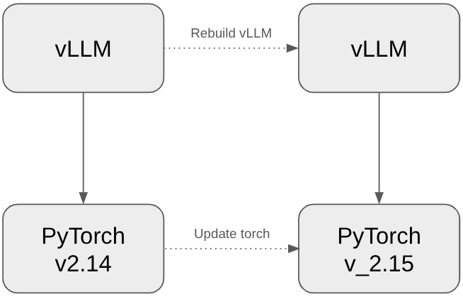
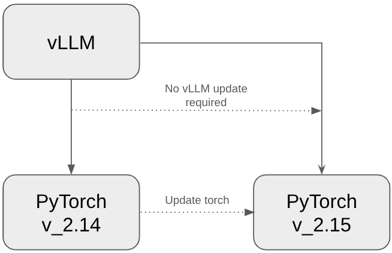
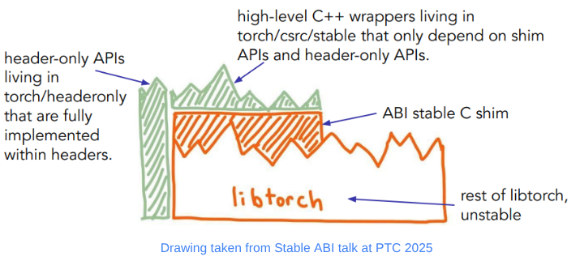
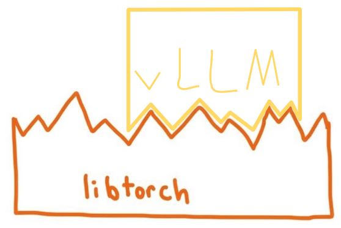
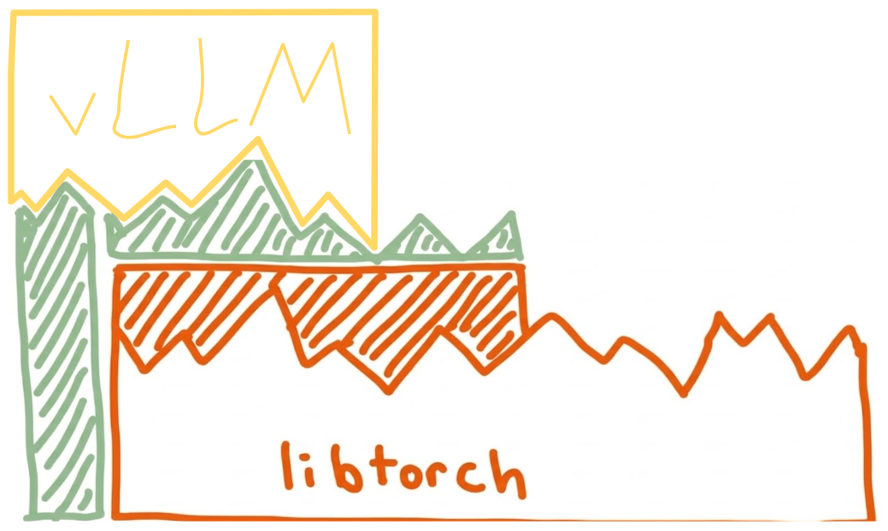

### Introduction

vLLM relies heavily on PyTorch, with frequent calls to LibTorch in its C++ backend. As a result, changes to LibTorch’s binary interface may require vLLM to be rebuilt and relinked, even when the APIs remain unchanged. What if we could update LibTorch without rebuilding vLLM? That’s where the LibTorch Stable ABI comes in. With a LibTorch Stable ABI, updating LibTorch does not require rebuilding or updating vLLM in order to keep using it. Instead, we could swap out the LibTorch wheel and import it directly into our vLLM package. As of v0.33.0, vLLM publishes LibTorch ABI Stable CUDA wheels.  

<div style="text-align: center;">
<figure style="display: inline-block; width: 49%; margin: 0; vertical-align: top;">

<figcaption>New torch requires vLLM to rebuild
</figcaption>
</figure>
<figure style="display: inline-block; width: 49%; margin: 0; vertical-align: top;">

<figcaption>vLLM can import new torch directly
</figcaption>
</figure>
</div>

### What Is the LibTorch Stable ABI?
What is a Stable ABI? When a software library (such as LibTorch) is compiled into a binary, it exposes symbols that other programs can link against. The application binary interface (ABI) defines how these separately compiled components interact, including how functions are called, how data is represented in memory, and how symbols are named. Changes to these details can break binary compatibility, even when the source-level APIs remain unchanged. For example, changes to data layouts, function signatures, or C++ name mangling can prevent a program compiled against one version of a library from working with another. A stable ABI defines a set of binary interfaces and compatibility guarantees that allow programs to continue working across library updates without needing to be rebuilt, as long as they use interfaces covered by those guarantees. 

PyTorch has implemented its own LibTorch Stable ABI, which consists of three components. The first is a stable C shim that exposes a limited subset of LibTorch's functionality through a C API. This allows extensions to be built against one version of PyTorch and run against compatible versions without needing to be rebuilt. The second component is a set of C++ convenience wrappers, provided in header files, that build on top of the C shim. These wrappers provide higher-level C++ APIs instead of requiring developers to work directly with the lower-level C API. The third component is a collection of header-only utilities in the torch::headeronly namespace. These utilities are implemented entirely in header files and do not depend on libtorch.so, allowing them to be used without linking against LibTorch.




### Why Stable ABI Matters
Before adopting the LibTorch Stable ABI, vLLM often needed to rebuild its binaries to support a new PyTorch version. It currently takes vLLM over a month after a new PyTorch release to update its support for that version. As a result, downstream users may have to wait to take advantage of new PyTorch features through vLLM.
With the Stable ABI, users can upgrade to a compatible PyTorch version without rebuilding vLLM, provided the new version meets vLLM's compatibility requirements and the C++ and CUDA environments remain compatible. This allows users to adopt new PyTorch versions without waiting for a corresponding vLLM rebuild. For package distributors, the Stable ABI also decouples vLLM wheel releases from the PyTorch release cycle: a new PyTorch release no longer necessarily requires a new vLLM build, allowing the same vLLM binaries to work across multiple compatible PyTorch versions.


<div style="text-align: center;">
<figure style="display: inline-block; width: 49%; margin: 0; vertical-align: top;">

<figcaption>vLLM needs to change as LibTorch changes
</figcaption>
</figure>
<figure style="display: inline-block; width: 49%; margin: 0; vertical-align: top;">

<figcaption>vLLM can change independent of LibTorch
</figcaption>
</figure>
</div>


### Tradeoffs
Migrating vLLM to the Stable ABI comes with two main trade-offs: a more limited API surface and a small runtime overhead. Although the Stable ABI supports only a subset of LibTorch's APIs, it covers most of the APIs commonly used in vLLM, allowing us to migrate nearly all of its LibTorch API usage without workarounds. One exception is the method is_pinned(), which did not have a stable equivalent during the migration, so we had to replace
```python
if (cpu_tensor.is_pinned())
```
with 
```python
std::array<StableIValue, 2> is_pinned_stack{
     torch::stable::detail::from(cpu_tensor),
     torch::stable::detail::from(std::nullopt)};
 TORCH_ERROR_CODE_CHECK(torch_call_dispatcher(
     "aten::is_pinned", "", is_pinned_stack.data(), TORCH_ABI_VERSION));
 if (torch::stable::detail::to<bool>(is_pinned_stack[0]))
```
This was the only major API limitation for in-tree vLLM, and an is_pinned() stable method was added in torch 2.14. 
 
The runtime overhead comes primarily from dispatch through the PyTorch dispatcher and the boxing and unboxing of StableIValue arguments and return values. Dispatch overhead is on the order of a few microseconds and the overhead from boxing and unboxing is even smaller. For most kernels, this overhead is negligible relative to execution time and becomes significant only in rare cases of frequently launching very short-running kernels without optimizations such as CUDA graphs. We observed no noticeable runtime regressions from the migration.


<style>
.abi-story__row {
  display: grid;
  grid-template-columns: minmax(0, 3fr) minmax(14rem, 1fr);
  column-gap: 2rem;
}
.abi-story__copy { grid-column: 1; grid-row: 1; min-width: 0; padding-bottom: 1.5rem; }
.abi-story__event { grid-column: 2; grid-row: 1; min-width: 0; border-left: 3px solid #6b7280; padding: 0 0 1.5rem 1rem; }
.abi-story__copy > :first-child, .abi-story__event > :first-child { margin-top: 0; }
.abi-story__copy > :last-child, .abi-story__event > :last-child { margin-bottom: 0; }
.abi-story__row:last-child > * { padding-bottom: 0; }
.abi-story__table { max-width: 100%; overflow-x: auto; }
@media (max-width: 48rem) {
  .abi-story__row { grid-template-columns: minmax(0, 1fr); }
  .abi-story__copy { padding-bottom: 0; }
  .abi-story__event { grid-column: 1; grid-row: 2; margin-bottom: 1.5rem; }
}
</style>

<div class="abi-story">
<div class="abi-story__row">
<div class="abi-story__copy">
<h3>Migrating vLLM to the Stable ABI</h3>
<p>Migrating an extension to the stable ABI is a mostly mechanical endeavor, replacing calls to unstable APIs with those of stable APIs.</p>
<p>The challenge is ensuring everything goes smoothly and is complete, since even one unstable dependency means the whole library is unstable. We started by identifying which APIs vLLM used that were not yet supported by the Stable ABI. Where we found gaps, we worked to add the missing stable APIs upstream in PyTorch (see the <a href="https://github.com/vllm-project/vllm/issues/26946">RFC to make vLLM stable</a>).</p>
</div>
<div class="abi-story__event">
<h4>Timeline</h4>
<p><strong>October 15, 2025</strong><br>RFC opened to begin discussion of migrating to the Stable ABI. <a href="https://github.com/vllm-project/vllm/issues/26946">RFC</a></p>
</div>
</div>

<div class="abi-story__row">
<div class="abi-story__copy">
<p>Other requirements for migrating an extension include using Python for AutogradFunctions and meta functions, since PyTorch's stable ABI does not support these yet, and making sure the ops are registered through the PyTorch dispatcher with TORCH_LIBRARY. Fortunately, the in-tree vLLM implementation already met these requirements, so the bulk of the work involved replacing unstable APIs with stable equivalents and verifying that the migrated code preserved the original behavior.</p>
</div>
<div class="abi-story__event">
<p><strong>December 29, 2025</strong><br>First migration PR opened: <a href="https://github.com/vllm-project/vllm/pull/31509">PR #31509</a></p>
</div>
</div>

<div class="abi-story__row">
<div class="abi-story__copy">
<p>To help with this process, we created skills and used agents to help with the migration process (see <a href="https://github.com/janeyx99/abi-stable-skills">abi-stable-skills</a>). These skills helped assess the migration requirements and can help automate many other parts of the migration process. The most-used skill was migrate-to-stable-apis, which defined the mappings between unstable and stable APIs and helped prevent common issues, such as agents making unrelated changes beyond the scope of the migration.</p>
</div>
<div class="abi-story__event">
<p><strong>March 19, 2026</strong><br>First migration PR closed.</p>
</div>
</div>

<div class="abi-story__row">
<div class="abi-story__copy">
<p>Given vLLM's size and its millions of users, we couldn't simply hand the entire migration to an agent and hope that everything goes smoothly. We needed to verify that every line we updated was working just as it did before, so we broke the work into smaller, manageable changes that could be reviewed and tested incrementally. We created a separate stable library, _C_stable_libtorch.abi3.so, and gradually moved kernels into it in batches. This broke the migration into small, manageable updates so that the maintainer and we could check every line of code before it was merged into vLLM. This manual review, along with unit and performance tests, helped us verify that the migration preserved behavior and did not introduce noticeable regressions.</p>
<p>We also needed to verify that the new library no longer depended on unstable PyTorch ABI symbols. For this we used <a href="https://pypi.org/project/torch-abi-audit/">torch-abi-audit</a>, which traces compiled libraries to identify stable and unstable PyTorch symbol usage. Reaching zero unstable PyTorch symbols in the audited library provided evidence that its PyTorch ABI dependencies had been migrated successfully.</p>
</div>
<div class="abi-story__event">
<p><strong>March–June 19, 2026</strong><br>12+ more PRs were merged, making vLLM in-tree torch ABI Stable.</p>
</div>
</div>

<div class="abi-story__row">
<div class="abi-story__copy">
<p>Migrating vLLM source alone does not establish that the entire vLLM wheel is ABI-stable. For the wheel to be completely stable, its compiled dependencies must be torch ABI Stable as well. vLLM currently has seven dependencies that also depend on LibTorch. These are:</p>
<div class="abi-story__table">
<table>
<thead><tr><th>Dependency</th><th>Migrated on vLLM Fork</th><th>Migrated Upstream</th></tr></thead>
<tbody>
<tr><td>FlashMLA</td><td>✅</td><td>✅</td></tr>
<tr><td>DeepGEMM</td><td>✅</td><td>🚧 Work in progress</td></tr>
<tr><td>FlashAttention-2</td><td>✅</td><td>🚧 PR open to make it stable</td></tr>
<tr><td>FlashAttention-3</td><td>✅</td><td>✅</td></tr>
<tr><td>DeepSelect</td><td>✅</td><td>🚧 Work in progress</td></tr>
<tr><td>FlashKDA</td><td>✅</td><td>❌</td></tr>
<tr><td>QuTLASS</td><td>N/A</td><td>✅</td></tr>
</tbody>
</table>
</div>
<p>After the in-tree vLLM code had been migrated, each of these dependencies was migrated to the torch Stable ABI as well, making the entire vLLM wheel LibTorch ABI Stable. We also added a CI check using <a href="https://pypi.org/project/torch-abi-audit/">torch-abi-audit</a> to verify that every compiled library in the vLLM wheel remains torch ABI Stable.</p>
</div>
<div class="abi-story__event">
<p><strong>July–August 2026</strong><br>vLLM pinned stable FlashMLA, QuTLASS, FlashAttention 2, FlashKDA, and FlashAttention 3.</p>
</div>
</div>

<div class="abi-story__row">
<div class="abi-story__copy">
<h3>Challenges Along the Way</h3>
<p>As mentioned earlier, migrating to the Stable ABI was largely a mechanical process of replacing unstable API calls and headers with their stable counterparts. The biggest challenges came from working in a large, rapidly evolving project. Files were frequently changing upstream, so we had to keep our migration up to date and resolve merge conflicts carefully to avoid introducing unintended changes. Occasionally, upstream changes introduced new API usage without a direct Stable ABI equivalent. In these cases, we had to find alternatives or wrappers that preserved the original behavior.</p>
<p>Each dependency also presented its own challenges, from differences in build and packaging processes to differences in how operators were registered and imported in Python. DeepGEMM was a particularly challenging dependency for many reasons. First, it was registering its operators using pybind11, which meant we had to update it to register its ops with TORCH_LIBRARY before we migrated to the stable ABI. Also, around the same time as our Stable ABI migration, DeepGEMM was transitioning from version 1.x to version 2.0, bringing a rapid stream of changes. This transition introduced a new dependency, DeepJIT, which depended on LibTorch and therefore needed to be migrated to the Stable ABI first. Around this same time, vLLM was bouncing back and forth between using DeepSeek's upstream repo and its own fork before finally settling on its own fork for the DeepGEMM library.</p>
</div>
<div class="abi-story__event">
<p><strong>September 13, 2026</strong><br>vLLM pinned stable DeepSelect.</p>
</div>
</div>

<div class="abi-story__row">
<div class="abi-story__copy">
<p>Once the changes settled down, we migrated DeepJIT to the Stable ABI and moved vllm-project/DeepGEMM's operator registration from pybind11 to TORCH_LIBRARY. Since this was a large merge, we waited a few days before migrating to the Stable ABI. Just as we were about to merge, vLLM merged its branch with upstream, requiring us to make a substantial update to the Stable ABI. We were finally able to migrate DeepGEMM to the Stable ABI, and as of October 15, 2026, vLLM and its build dependencies are all torch ABI Stable.</p>
</div>
<div class="abi-story__event">
<p><strong>October 15, 2026</strong><br>vLLM pinned stable DeepGEMM, making the vLLM CUDA wheel completely torch ABI Stable—exactly one year after #26946 was opened.</p>
</div>
</div>
</div>

### Example run on newer torch
```python
import importlib
import torch
import vllm

print(f"PyTorch runtime: {torch.__version__}")
print(f"vLLM: {vllm.__version__}")

# This module contains vLLM operators registered with STABLE_TORCH_LIBRARY.
stable_extension = importlib.import_module("vllm._C_stable_libtorch")

x = torch.arange(16, device="cuda", dtype=torch.float32).reshape(2, 8) - 8
out = torch.empty(2, 4, device="cuda", dtype=x.dtype)
torch.ops._C.silu_and_mul(out, x)
print(f"silu_and_mul output:\n{out}")
```
**Output**

Build and run vLLM with torch 2.14.1

```
python stable_abi_demo.py           
PyTorch runtime: 2.14.1+cu132
vLLM: 0.1.dev24235+gc9af9acc6.d20261030
silu_and_mul output:
tensor([[1.0731e-02, 1.9132e-02, 2.9671e-02, 3.3464e-02],
        [0.0000e+00, 3.6553e+00, 1.0570e+01, 2.0004e+01]], device='cuda:0')
```

Update the torch wheel to torch==2.15.0:
```
uv pip install torch==2.15 \
  --index-url https://download.pytorch.org/whl/cu132
```
Rerun the script:
```
python stable_abi_demo.py
PyTorch runtime: 2.15.0+cu132
vLLM: 0.1.dev24235+gc9af9acc6.d20261030
silu_and_mul output:
tensor([[1.0731e-02, 1.9132e-02, 2.9671e-02, 3.3464e-02],
        [0.0000e+00, 3.6553e+00, 1.0570e+01, 2.0004e+01]], device='cuda:0')
```
### Future work
Now that vLLM’s CUDA build is on the torch Stable ABI, our next steps are to make all of vLLM’s builds ABI Stable. This includes migrating the CPU and ROCm builds as well. These migrations are not as large as the CUDA migration, but are still important parts of the vLLM ecosystem. Fortunately, the ROCm build already shares many of the same source files as the CUDA build. The .cu files are converted to .hip files through a hipify process and are thus already torch ABI Stable. Only a few ROCm-specific files remain to be migrated to the torch Stable ABI.


- PyTorch upstream updates to get rid of wrappers (mostly in DeepGEMM)
- More tests to make sure everything is truly stable


### Acknowledgement to main contributors

- vLLM Community: Shengqi Chen (main coordinator), Jiangyun Zhu (DeepSelect fork migration), Thien Tran (FlashKDA fork migration), Roberto L. Castro (upstream QuTLASS migration), Kaichao You (roadmap), and all maintainers who have reviewed our PRs and gave suggestions
- PyTorch Community: Jane Xu (project lead, FlashMLA migration in both fork & upstream, abi-stable-skills project), Chris Leonard (major migration work), Mikayla Gawarecki (early-stage migration work for in-tree source), Ralf Gommers (torch-abi-audit project)
- DeepSeek: Chenggang Zhao, Yichen Yan, Shengyu Liu
